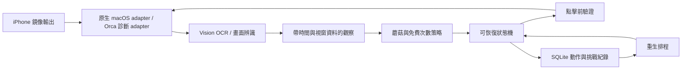

# Olimar 系統設計

## 目標

在 macOS 操作目前 iPhone 鏡像輸出的 Pikmin Bloom，尋找免費席位，依蘑菇類型選色 → 自動 → GO，記錄挑戰與重生時間。第一版可觀察、預演、執行單次派遣與有界監控；無法辨識就停下並保留證據。

## 模組邊界

- `domain`：蘑菇種類、大小、推薦皮克敏、最小隊伍、免費席位規則，不依賴 GUI。
- `device`：持續運作的 Swift 原生截圖／點擊 adapter，並保留 `orca computer` 診斷方式；只操作指定 bundle/window，截圖與 points/pixels 轉換，拒絕失效、越界或尺寸變動的點擊。
- `vision`：以 macOS Vision OCR（Swift helper）辨識繁中／英文文字與矩形，產生可追溯 Observation。遊戲畫面無 accessibility，不能假造元素。
- `controller`：探險清單→詳細頁→加入→顏色→自動→GO→確認派出。每步重新截圖；券提示、未知畫面、辨識失敗或缺少證據即停止。GO 不盲目重試。
- `store`：SQLite 持久化每日使用與 pending 派遣，單一執行鎖防止兩個程序重複派遣；實際顯示的每日次數是重要依據，需涵蓋手動操作。
- `scheduler`：已觀察戰鬥完成 + 300 秒的候選觀察時間，種類須重讀；倒數只能作估計，其他玩家加入可改變倒數。監控有 timeout、poll 間隔、SIGINT 與 stop file。
- `cli`：`doctor`、`observe`、`plan`／dry-run、`run --once --live`、有界 `watch`、狀態／log。read-only 命令不點擊；只有明確 live 才改遊戲狀態。

## 重要不變條件

不使用蘑菇券或付款。已 5 人、剩餘次數 0、未知次數、無法確認免費加入或皮克敏不足時不派遣。頭像名稱的 OCR 數量只能當作下限；以按鈕及券圖示等畫面證據判斷能否免費加入。GO 前再次取得畫面，不沿用清單中的人數。若加入競態導致券視窗，絕不確認用券。每日按遊戲當地午夜重設，預設 `Asia/Taipei` 可設定。模糊派遣結果維持 pending，禁止再次 GO，要求重新觀察或人工 reconcile。只記錄實際證據，不把點擊成功當作派遣成功。

## 實作與驗收

Python 3.11+、stdlib 優先；Swift Vision helper 作 macOS 原生 OCR。所有 live 資料放 `runtime/` 並 gitignore。核心以錄製畫面、fake device、fake clock 驗證：毒選白、滿 5 人停、0 次停、GO 後券競態停、跨午夜與重啟不重複 GO、pixels/points 轉換與視窗變動停。實機先完成 doctor/observe/plan，再執行一次可驗證的免費流程；沒有席位就報告具體原因。

## 搶菇速度

使用者要求以手速為核心。將 AI、編譯、策略推導與全畫面研究移出派遣熱路徑。暖機時編譯 OCR／原生 helper、快取穩定佈局，規劃候選地點及選色。熱路徑使用局部辨識與原生 macOS 點擊 adapter，量測發現空位、進詳情、進選隊、自動、GO 各階段及總耗時。Orca adapter 保留為診斷與相容方式；實測其操作常有約 1.5 秒點擊延遲，不能只減少 Python sleep 就宣稱快速。

快速 adapter 仍須鎖定 iPhone 鏡像的 bundle、frontmost pid、window id 與 bounds，失焦或視窗變动停止。選色→自動用短且有上限的等待，GO 前取得新隊伍數與券圖示證據，GO 不重試。對已預排的重生時間可提高附近的輪詢頻率，但完成時間可能被其他參加者改變，不能只按預估時間盲點。記錄實測延遲，不保證擊敗其他玩家的手速或網路延遲。

局部 OCR 用於等待畫面就緒。參加、篩色與自動等操作前另讀完整畫面，避免漏掉區域外的券彈窗；每次約增加 0.24 秒觀察成本。輪播進度包含新卡或同卡明顯水平位移，並等待位置穩定；實機慣性約 1–2.4 秒，最多等待 4 秒，未停穩就停止而不點擊。鏡像在手機解鎖使用時會中斷，這時畫面無法被辨識為遊戲，程式停止。
